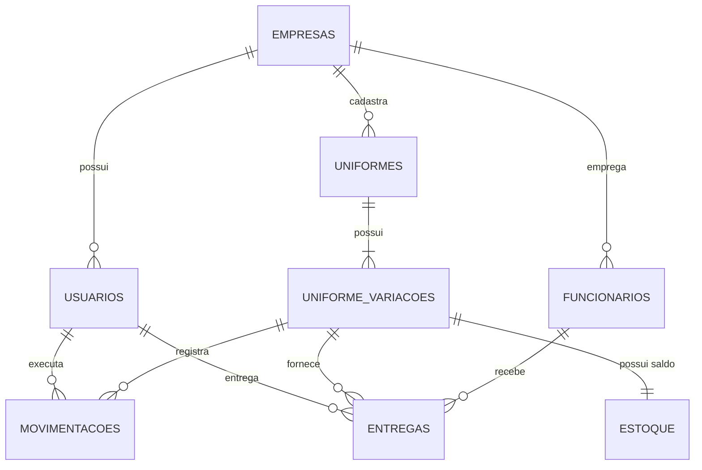

# UniControl — Especificação Técnica Final do Sistema (Spec Final)

> **Documento:** Especificação Técnica, Arquitetural e Guia Operacional Passo a Passo  
> **Projeto:** UniControl — Sistema Inteligente de Controle de Estoque de Uniformes e EPIs  
> **Versão:** 2.0 (Final Consolidada)  
> **Repositório Oficial:** [github.com/ryannesoares56-ux/UniControl](https://github.com/ryannesoares56-ux/UniControl)

---

## 1. Objetivo e Visão Geral do Produto

O **UniControl** é uma plataforma web desenvolvida para empresas e indústrias que necessitam gerenciar com rigor a compra, a armazenagem e a distribuição de uniformes e Equipamentos de Proteção Individual (EPIs) aos seus colaboradores.

O sistema elimina o uso de planilhas despadronizadas e fichas de papel, centralizando cadastro, controle físico de saldos, rastreabilidade de movimentações e protocolos de entrega com comprovação legal em uma arquitetura **multiempresa nativa**.

---

## 2. Perfis de Usuários e Permissões (RBAC)

O sistema possui controle de acesso rigoroso baseado em papéis (Role-Based Access Control), validado no servidor a cada requisição:

| Perfil | Escopo e Acessos |
|---|---|
| **Visitante / Novo Usuário** | Acesso à Vitrine (`index.php`), Tela de Login (`login.php`) e Tela de Auto-Cadastro de Empresa e Conta (`cadastro.php`). |
| **Operador** | Gestão de funcionários da empresa, catálogo de uniformes e variações, registro de entradas/saídas no estoque, protocolo de entregas, impressão de recibos e consulta ao dashboard de alertas. **Bloqueado** em telas de gestão global de empresas e usuários. |
| **Administrador** | Todas as permissões do operador, além de poder cadastrar e gerenciar empresas clientes, criar novos operadores/administradores, redefinir senhas e alternar entre filiais/empresas pelo seletor de empresa ativa. |

---

## 3. Requisitos Funcionais Atualizados

- **RF01 (Autenticação):** Login com e-mail e senha com validação de hash criptográfico e proteção de rotas restritas.
- **RF01-B (Auto-Cadastro / Onboarding):** Novos clientes podem se cadastrar (`cadastro.php`), informando nome, dados da empresa, e-mail e senha, sendo criados automaticamente como Administradores.
- **RF02 (Controle de Acesso):** Restringir as telas de Empresas (`empresas.php`) e Usuários (`usuarios.php`) estritamente a administradores, barrando acessos diretos com erro HTTP 403.
- **RF03 (Gestão Multiempresa):** Cadastro de empresas clientes e filiais, com controle de status (ativo/inativo).
- **RF03-B (Alternador Multiempresa):** O administrador pode alternar a empresa ativa pela barra de navegação superior para visualizar e operar os dados de cada filial individualmente.
- **RF04 (Cadastro de Funcionários):** Cadastro de colaboradores vinculados à empresa ativa (nome, matrícula única, setor, cargo e status ativo/inativo).
- **RF04-B (Edição e Inativação):** Possibilidade de atualizar dados cadastrais de funcionários e inativá-los (colaboradores inativos deixam de aparecer nas opções de entrega).
- **RF05 (Catálogo de Peças):** Cadastro de itens do catálogo de uniformes por categoria e descrição.
- **RF06 (Grade de Variações e SKU):** Cadastro de variações vinculadas a uma peça (tamanho, cor, código SKU, estoque mínimo e carga de estoque inicial).
- **RF07 (Gestão de Movimentações):** Manter o estoque atualizado a cada operação de entrada (compra/reposição), saída (descarte/transferência), devolução ou baixa (avaria).
- **RF08 (Protocolo de Entrega):** Registro da entrega de uniformes ao colaborador, abatendo o saldo do estoque automaticamente em transação segura.
- **RF08-B (Termo Legal para Impressão):** Emissão do Termo de Recebimento e Responsabilidade de Uniforme (`recibo_entrega.php`), pronto para impressão em A4 com cláusulas da CLT/NR-6 e campos de assinatura do colaborador e almoxarife.
- **RF09 (Trava Anti-Furo de Estoque):** Bloqueio obrigatório no servidor caso a quantidade solicitada em uma entrega ou saída seja superior ao saldo físico em estoque, exibindo a quantidade disponível.
- **RF10 (Dashboard com 4 Indicadores):** Exibição em tempo real de: 1) Total de peças físicas em estoque, 2) Total de colaboradores ativos, 3) Itens com estoque igual ou abaixo do mínimo, 4) Total de entregas realizadas no mês corrente.
- **RF11 (Destaque Visual de Estoque Baixo):** Listagem no estoque com cores destacadas (amarelo para estoque baixo e vermelho para itens esgotados).
- **RF12 (Vitrine do Produto com Simulador Dinâmico):** Landing page de apresentação (`index.php`) com calculador interativo em tempo real de redução de extravios e horas economizadas, tabela comparativa e atalhos de teste rápido.

---

## 4. Requisitos Não Funcionais e Segurança

1. **Criptografia de Senhas:** Senhas nunca armazenadas em texto puro, protegidas com o algoritmo nativo `password_hash($senha, PASSWORD_DEFAULT)` do PHP (bcrypt).
2. **Prepared Statements:** 100% das operações com banco de dados utilizam consultas parametrizadas via PDO, impedindo injeção de SQL.
3. **Isolamento de Dados Multi-Tenant:** Todas as queries de catálogo, estoque, colaboradores, movimentações e entregas filtram obrigatoriamente por `empresa_id` armazenada na sessão do usuário.
4. **Sem Dependências Pesadas:** Frontend desenvolvido em HTML5 e CSS3 puros, garantindo carregamento ultrarrápido e compatibilidade em qualquer dispositivo/navegador.
5. **Portabilidade de Banco de Dados:** Suporte dual automático: conecta ao MySQL corporativo e, caso não haja credenciais configuradas no laboratório, inicializa e popula instantaneamente um banco SQLite local embutido (`database/unicontrol.sqlite`).

---

## 5. Modelo de Dados Relacional (DER)

O banco de dados é estruturado em 8 tabelas relacionais com integridade referencial:



### Dicionário de Tabelas:
- **`empresas`**: `id` (PK), `nome`, `cnpj`, `status`, `criado_em`.
- **`usuarios`**: `id` (PK), `empresa_id` (FK), `nome`, `email`, `senha`, `nivel`, `status`, `criado_em`.
- **`funcionarios`**: `id` (PK), `empresa_id` (FK), `nome`, `matricula`, `setor`, `cargo`, `status`, `criado_em`.
- **`uniformes`**: `id` (PK), `empresa_id` (FK), `nome`, `categoria`, `descricao`, `criado_em`.
- **`uniforme_variacoes`**: `id` (PK), `uniforme_id` (FK), `tamanho`, `cor`, `sku`, `estoque_minimo`, `criado_em`.
- **`estoque`**: `id` (PK), `variacao_id` (FK UNIQUE), `quantidade`, `atualizado_em`.
- **`movimentacoes`**: `id` (PK), `variacao_id` (FK), `usuario_id` (FK), `tipo`, `quantidade`, `motivo`, `data_movimentacao`.
- **`entregas`**: `id` (PK), `funcionario_id` (FK), `variacao_id` (FK), `usuario_id` (FK), `quantidade`, `observacao`, `data_entrega`.

---

## 6. Critérios de Aceite Formais (Gherkin)

### Cenário 1: Tentativa de entrega superior ao saldo disponível (RF09)
- **Dado** que a variação "Camisa Polo - M" possui 3 unidades em estoque,
- **Quando** o operador tentar registrar uma entrega de 5 unidades para um colaborador,
- **Então** o sistema deve recusar a gravação no banco de dados e exibir a mensagem de bloqueio informando que apenas 3 unidades estão disponíveis.

### Cenário 2: Entrega com quantidade válida (RF08 e RF08-B)
- **Dado** que a variação "Calça Operacional - 42" possui 10 unidades em estoque,
- **Quando** o operador confirmar a entrega de 2 unidades para o colaborador "Carlos Alberto",
- **Então** o saldo em estoque deve ser reduzido automaticamente para 8 unidades, uma movimentação de saída deve ser registrada no histórico e o botão para emitir o termo de recebimento assinado deve ficar disponível.

### Cenário 3: Restrição de acesso por perfil de usuário (RF02)
- **Dado** que um usuário com nível "operador" está autenticado no sistema,
- **Quando** ele tentar acessar diretamente pela barra de endereços do navegador a URL `http://localhost:8000/empresas.php` ou `http://localhost:8000/usuarios.php`,
- **Então** o sistema deve negar o acesso com resposta HTTP 403 e redirecioná-lo para o painel com aviso de permissão insuficiente.

### Cenário 4: Alerta visual de reposição (RF10 e RF11)
- **Dado** que uma peça possui estoque mínimo definido como 5 unidades e saldo atual de 4 unidades,
- **Quando** o painel de controle ou a tela de estoque forem carregados,
- **Então** o item deve ser contabilizado no cartão de "Estoque Baixo" e a linha da tabela deve ser destacada visualmente com a badge de aviso.

---

## 7. Guia Operacional Passo a Passo (AI & Human Execution Guide)

> **Instruções estritas:** Siga rigorosamente os passos abaixo para inicializar, testar e operar o UniControl sem falhas.

### Passo 1: Localização dos Arquivos
Certifique-se de que o diretório de trabalho do projeto esteja posicionado em:
```text
C:\Users\Aluno\Documents\Unicontroll
```

### Passo 2: Inicialização do Servidor Web
Existem duas maneiras equivalentes de iniciar o programa:

- **Método A (Automático com 1 clique):**  
  Execute o arquivo `iniciar_sistema.bat` localizado na raiz da pasta. Ele iniciará o servidor PHP embutido na porta `8000` e abrirá o navegador automaticamente.
- **Método B (Manual via Terminal PowerShell):**  
  Execute o comando:
  ```powershell
  & "C:\xampp\php\php.exe" -S 127.0.0.1:8000
  ```

### Passo 3: Acesso no Navegador
Abra qualquer navegador moderno (Google Chrome, Microsoft Edge ou Firefox) e digite a URL:
```text
http://localhost:8000
```
- Você verá a **Vitrine Oficial (Landing Page)** com apresentação comercial e simulador interativo.

### Passo 4: Autenticação de Teste
Para acessar os módulos operacionais, clique em **"Fazer Login"** ou vá direto para `http://localhost:8000/login.php`:

| Tipo de Usuário | E-mail de Acesso | Senha |
|---|---|---|
| **Administrador** | `admin@unicontrol.com` | `admin123` |
| **Operador** | `operador@unicontrol.com` | `operador123` |

*(Também é possível clicar no link "Criar uma conta agora" para criar uma empresa e administrador novos).*

### Passo 5: Roteiro de Teste dos Fluxos Principais
1. **Verificar Indicadores:** Acesse o **Dashboard** e confirme os 4 cartões e a tabela de alertas.
2. **Consultar Estoque:** Acesse **Estoque Geral** e observe os itens com fundo amarelo/vermelho (saldo menor ou igual ao mínimo).
3. **Cadastrar Colaborador:** Vá em **Funcionários**, preencha o formulário e confirme a gravação.
4. **Cadastrar Peça e Grade:** Vá em **Catálogo de Peças**, cadastre uma peça (ex: "Jaleco Hospitalar") e adicione sua variação com tamanho, cor e estoque inicial.
5. **Realizar Entrega:** Vá em **Entregas**, selecione o funcionário, a peça e registre.
6. **Emitir Recibo:** Na tabela de entregas, clique no botão **`🖨️ Recibo`** e confira o termo legal pronto para impressão.
7. **Simular Trava de Estoque:** Tente realizar uma entrega com quantidade maior que o saldo e comprove a mensagem de bloqueio.

---

## 8. Arquitetura de Arquivos do Projeto

```text
Unicontroll/
├── assets/
│   ├── css/
│   │   ├── style.css          # Estilos do sistema interno (painel, tabelas, forms)
│   │   └── landing.css        # Estilos da vitrine de apresentação
│   └── js/
│       └── app.js             # Validações dinâmicas e cálculo de saldo em tempo real
├── config/
│   └── database.php           # Conexão PDO segura (MySQL com fallback SQLite automático)
├── database/
│   ├── schema.sql             # Script DDL com as 8 tabelas relacionais
│   ├── seed.sql               # Dados iniciais para MySQL
│   ├── setup.php              # Instalador web do banco de dados
│   └── unicontrol.sqlite      # Banco SQLite embutido para execução imediata
├── includes/
│   ├── alerts.php             # Mensagens flash (sucesso, erro, alerta)
│   ├── auth.php               # Gerenciamento de sessão, autenticação e perfil
│   ├── footer.php             # Rodapé padrão e scripts
│   └── header.php             # Cabeçalho, sidebar e switcher multiempresa
├── cadastro.php               # Auto-registro de novas contas e empresas
├── dashboard.php              # Painel com indicadores, categorias e alertas
├── empresas.php               # Gestão multiempresa (exclusivo Administrador)
├── entregas.php               # Protocolo de entrega com trava anti-furo
├── estoque.php                # Listagem geral com destaque visual de estoque baixo
├── funcionarios.php           # Cadastro, edição e status de colaboradores
├── index.php                  # Vitrine comercial com simulador de economia
├── iniciar_sistema.bat        # Inicializador com 1 clique para Windows
├── login.php                  # Autenticação de usuários
├── logout.php                 # Encerramento seguro de sessão
├── movimentacoes.php          # Histórico de entradas, saídas, devoluções e baixas
├── recibo_entrega.php         # Termo formal de recebimento para impressão A4
├── uniformes.php              # Catálogo de peças e grade de variações
├── usuarios.php               # Gestão de usuários e permissões (exclusivo Administrador)
├── README.md                  # Apresentação do repositório no GitHub
└── SPEC_FINAL.md              # Este documento oficial de especificação final
```
